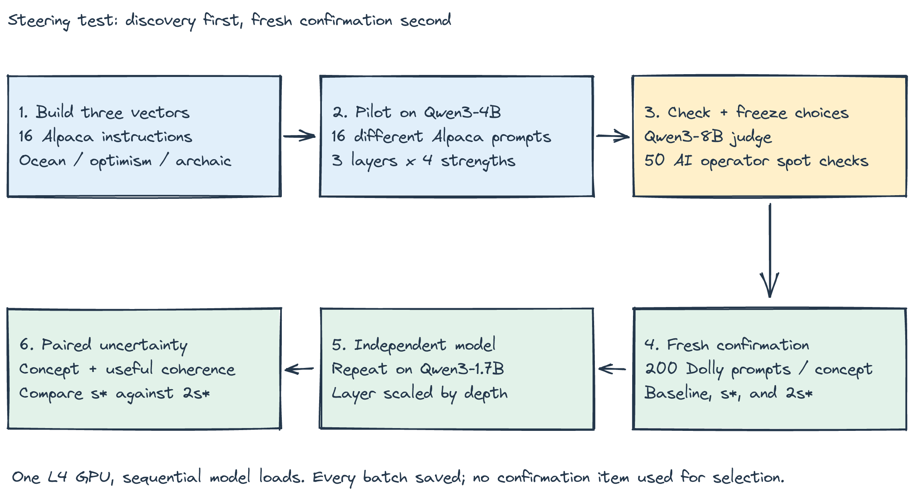
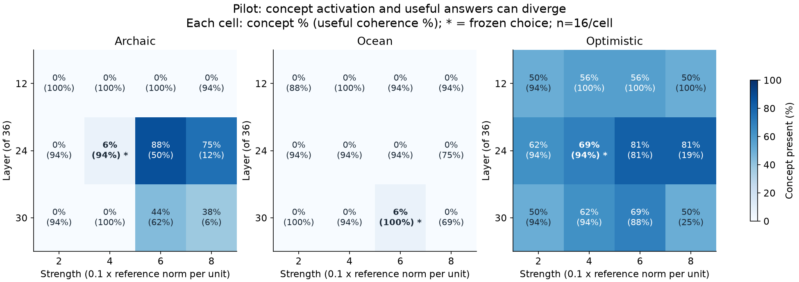
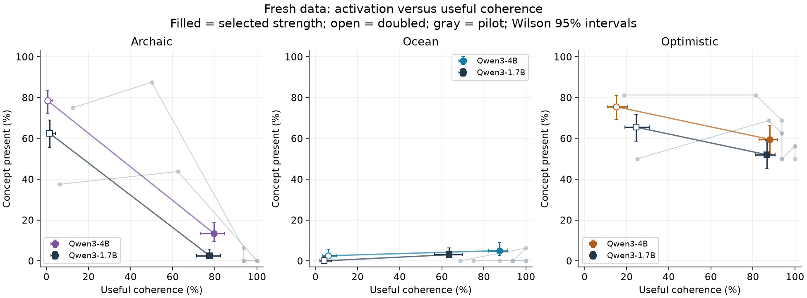
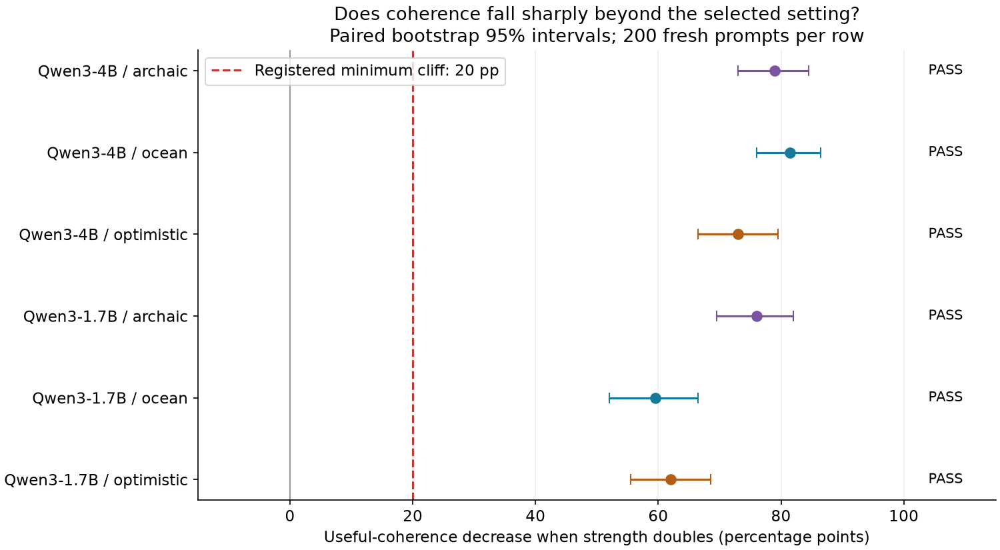

# Doubling a style vector cost Qwen3-4B 79 points of useful answers

*A pilot found promising settings. Fresh prompts and a second model showed why a convincing steering demo needs a much stronger evaluation.*

Turner and colleagues describe activation addition as controlling outputs “while preserving performance on off-target tasks.” That phrase in [their activation engineering paper](https://arxiv.org/abs/2308.10248) is the part an engineer should care about. Changing a model's tone is useful only if it can still do the job you called it for.

Anthropic's [Golden Gate Claude demonstration](https://www.anthropic.com/research/golden-gate-claude) made that dial memorable: amplifying an internal bridge feature made the model bring up the bridge in unrelated conversations. It used a different intervention from mine. I used only open Qwen checkpoints, and this experiment does not reproduce Anthropic's feature extraction.

My headline result is a **79.0 percentage-point drop in useful coherence** when I doubled an archaic-style vector on Qwen3-4B, from strength 4 to 8. The paired 95% bootstrap interval is **73.0 to 84.5 points**. Useful coherence fell from 79.5% to 0.5%, while archaic wording became much more common.

That's a large effect on this judge's labels. It doesn't mean every model has the same cliff, or that I found a useful setting just below it.

## What I tested

This is experiment 095b in my series of 100 experiments. In #095, an Eiffel Tower vector could make Qwen talk about the tower almost everywhere. Fluent sentences sometimes concealed a complete failure to answer the question. The follow-up therefore tracked relevance separately from readability.

I tested three concepts: ocean references, an optimistic tone, and archaic English. The generators were **Qwen/Qwen3-4B** and **Qwen/Qwen3-1.7B**, running sequentially in BF16 on an **NVIDIA L4**. Thinking was disabled, decoding was greedy, and each answer had an 80-token limit.

For each concept, I took 16 public Alpaca instructions and compared the model's final prompt-token activations with and without an explicit concept instruction. The mean difference became the steering direction. I normalized it against the ordinary activation magnitude at that layer, then added a scaled copy during both prompt processing and generation.

This is an ActAdd-inspired recipe. The instruction contrast, normalization, injection positions, and models differ from the source work. A failed result here cannot refute every activation-steering method.

The diagram separates constructing a vector, choosing its setting, and testing it on fresh prompts. The spot checks in this pipeline were performed by Codex, an AI operator, with no independent human annotator.

The pilot used 16 different Alpaca prompts, three layers, and four strengths per concept. That produced 576 steered answers plus 16 shared baseline answers. The selection rule favored concept activation while allowing at most two extra failed pilot answers compared with baseline.

Before confirmation, I committed one selected layer and strength per concept, the numerical predictions, and a fixed decision rule. Confirmation used **200 fresh Dolly instructions**, shared across conditions for paired comparisons. With baseline, selected strength, and doubled strength on both models, that was **2,800 answers**. It was 200 unique test questions, not 2,800 independent questions.

A separate, unsteered Qwen3-8B checkpoint judged concept presence, readability, and relevance. “Useful coherence” required both readability and relevance. I also measured each answer's perplexity under its unsteered generator, so fluent-looking failure wouldn't disappear into a single score.

## The pilot did not find three strong candidates

Each cell shows concept presence and, in parentheses, useful coherence. The starred settings were frozen before confirmation; the sharp trade-offs at stronger late-layer settings explain why simple concept maximization would be dangerous.

The chosen archaic setting was layer 24, strength 4. Ocean used layer 30, strength 6. Optimism used layer 24, strength 4. Layers are numbered from one, out of 36.

The pilot supported a meaningful absolute concept prediction only for optimism: at least 48.03% concept presence, with no more than 15.625 points of useful-coherence loss. For ocean and archaic English, uncertainty around one positive answer out of 16 pushed the derived concept floors to zero.

Those zero floors are embarrassing but essential to report. A test that allows zero concept activation cannot establish successful steering. Ocean also received a zero-loss ceiling because all 16 selected pilot answers preserved useful coherence. A tiny pilot had produced an unusually brittle quality prediction.

My second hypothesis was more demanding: doubling each selected strength would reduce useful coherence by at least 20 percentage points, including on the smaller model. One additional failed answer in five is a practically large deterioration. The cliff in #095 and the pilot's stronger settings motivated that direction.

## Fresh data exposed the trade-off

The filled markers are the frozen strengths; the open markers double them. The gray pilot curves and fresh-data intervals show why a visually attractive pilot point needs confirmation.

On Qwen3-4B, the selected archaic setting produced archaic language in just **13.5%** of answers, with **79.5%** useful coherence. Doubling strength increased archaic presence to **78.5%**, while useful coherence fell to **0.5%**. Getting much more of the style consumed almost all of the answer quality measured here.

Ocean was even less convincing as useful steering. At the selected strength, only **5.0%** of answers expressed the concept, with **87.5%** useful coherence. Doubling strength left **2.5%** concept presence and **6.0%** useful coherence. A collapsing output need not keep expressing the intended concept.

Optimism looked better on the larger model: the selected setting reached **59.5%** concept presence and **88.0%** useful coherence. Its registered absolute-rate and quality prediction passed. But an absolute optimism rate needs a baseline comparison: an ordinary assistant can already sound encouraging. The auxiliary paired baseline results in `writeup.md` address that question without changing the registered test.

This chart tests the actual cliff prediction against the frozen 20-point line. It distinguishes a dramatic effect on one model from a claim that survives transfer to another.

All six model/concept comparisons cleared the registered cliff margin. On the smaller Qwen3-1.7B, the declines were 76.0 points for archaic style, 59.5 for ocean, and 62.0 for optimism. The quality cliff transferred.

The joint registered verdict was **DISPROVEN** because ocean's selected setting violated the zero-loss prediction on both models. Across the six H1 tests, one passed, two failed, and three were unresolved. This rejects my combined prediction, without proving that every possible sweet spot is absent.

The auxiliary comparison also found a real measured optimism increase: on Qwen3-4B, concept presence rose from 21.5% at baseline to 59.5%, a paired gain of 38.0 points [31.0, 45.0]. That result is encouraging, but sentiment was the least reliable part of the judge check.

The main numerical table, including confidence intervals and each hypothesis status, is saved as `figures/table.png`. Rates use Wilson intervals; differences use 10,000 paired bootstraps over prompts. These intervals quantify uncertainty across sampled questions, conditional on the fixed vectors and labels.

## What surprised me, and what I got wrong

The quality of the judge check also bothered me. Codex inspected 50 pilot outputs blind to the Qwen judge's labels. Overall agreement was 86% for concept presence and 94% for useful coherence, clearing the registered 80% gate.

That pooled number concealed trouble. Optimism agreement was only **9 out of 15** checked examples. The ocean subset contained no operator-positive examples, so it offered no evidence that the judge could recognize successful ocean steering. There were zero human annotators. This falls short of independent human validation, and the reported verdict must be read with that limitation.

I also registered predictions that were too weak in one dimension and too strict in another. The zero concept floors and zero ocean loss allowance stayed in place. Quietly replacing them after seeing confirmation would have made the experiment look cleaner and its evidence worse.

## What I would do in production

1. **Gate on the original task.** Measure whether the answer satisfies the request alongside whether the desired style appears. Add task-specific correctness checks before calling an answer useful.

2. **Compare with an ordinary prompting baseline.** This run compared steering with an unsteered model, without the desired concept instruction. It did not establish that activation addition beats simply asking for the style.

3. **Treat each checkpoint as a new calibration problem.** Scaling a layer number by model depth is a testable shortcut, not a deployment guarantee. Retune on development data and reserve a fresh acceptance set.

4. **Validate the evaluator by concept.** Include genuine positive and negative examples, use independent human checks, and report disagreements. A pooled agreement score can hide the exact failure you care about.

5. **Test complete answers and recovery behavior.** An 80-token opening can be relevant while the full response fails. Evaluate longer generations, difficult requests, and a fallback that disables steering when quality drops.

## Limitations

This was one vector per concept and model, one decoding configuration, and a finite grid. The construction contrast may capture instruction wording as well as the intended concept. The judge shares a model family with the generators, and an AI operator is not human ground truth.

Most confirmation answers hit the token limit. Partial relevant answers counted as useful, factual correctness was not verified, and no broad capability benchmark was run. The bootstrap intervals exclude systematic labeling error, vector-construction uncertainty, and repeated-selection uncertainty. They are pointwise intervals with no multiplicity correction.

Timing: estimated 185 minutes; actual 269.6 minutes elapsed, including a 233.9-minute interruption. Two L4 allocations used an estimated 1.427 CU, below the 6 CU cap. Lifecycle accounting and its pruning caveat are in `results/timing.json`.

The engineering lesson I would carry forward is to measure what remains useful as carefully as what becomes steerable.

Code: <repo link placeholder>
