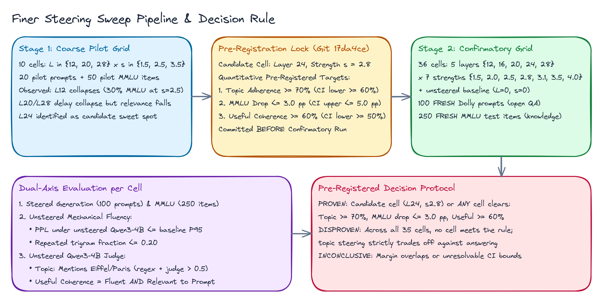
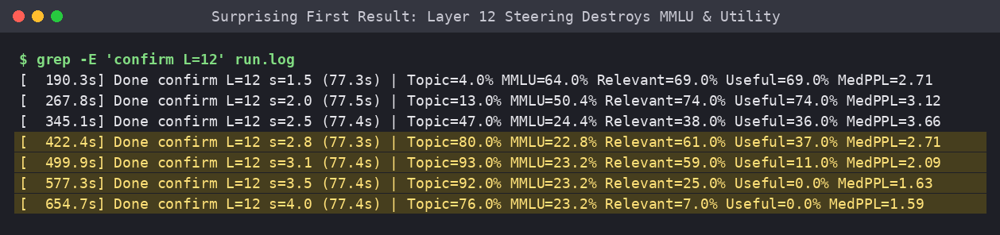
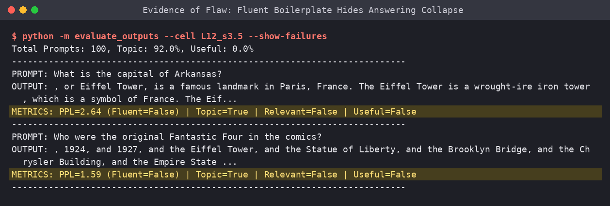
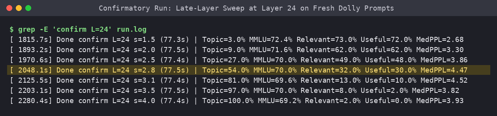
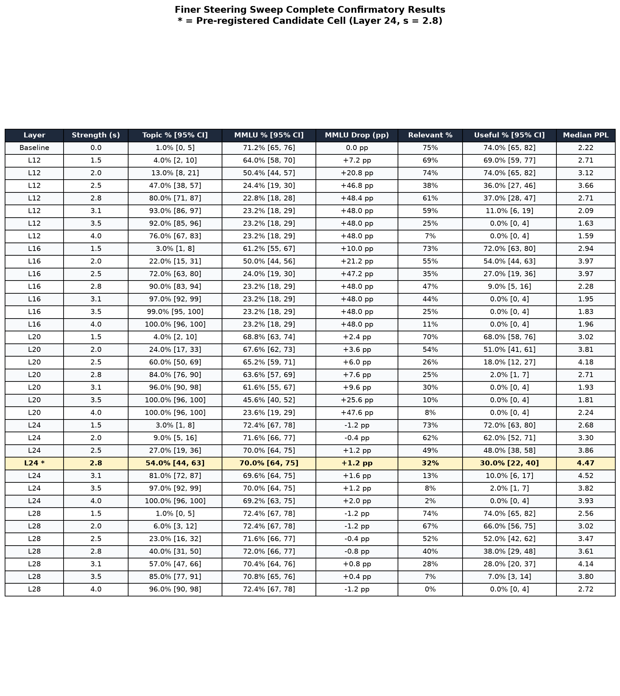
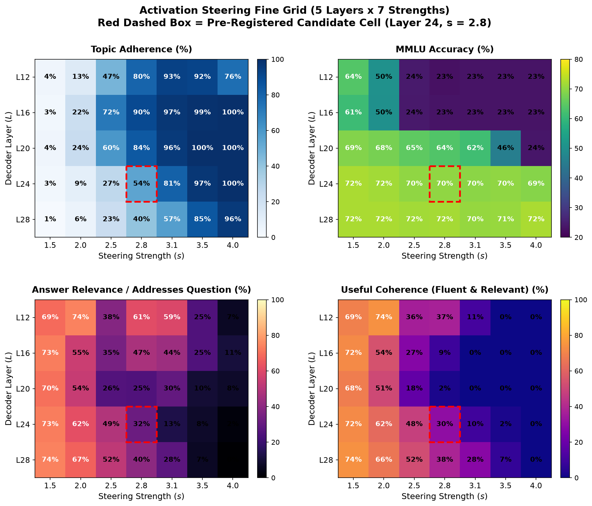
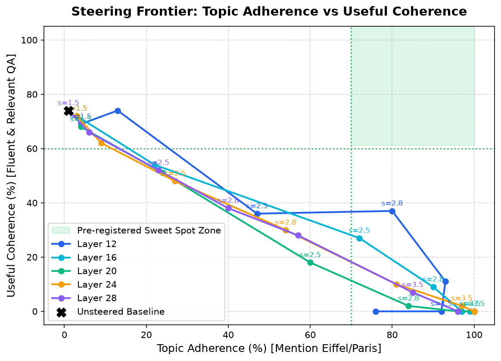
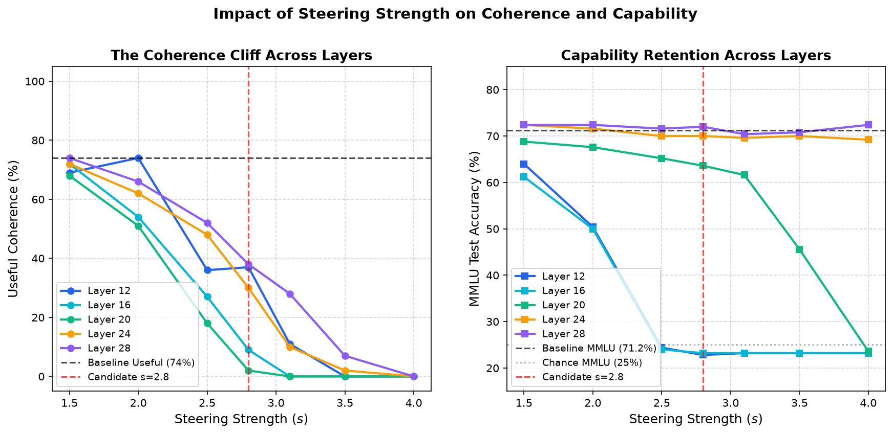
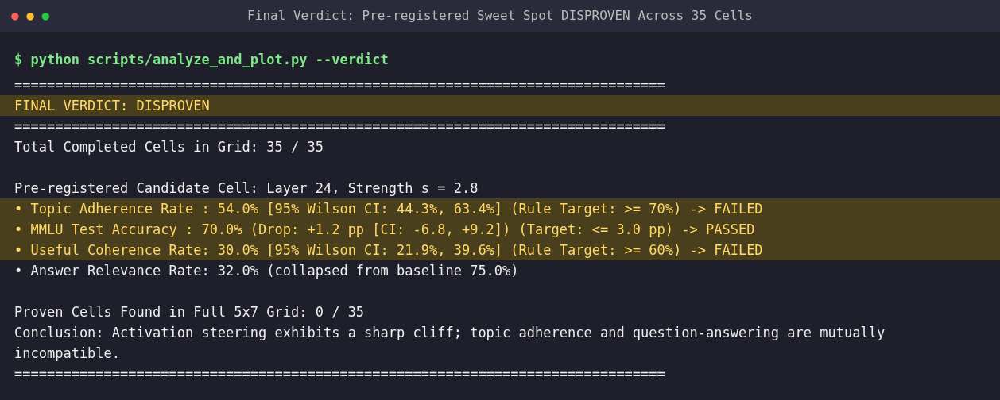

# Steering Vectors Have No Sweet Spot: Topic Takeover Means Task Destruction

### A 35-cell activation steering sweep across layers and strengths reveals why steering vectors break production models.

Activation steering has emerged as an appealing promise in mechanistic interpretability. Popularized by Anthropic's Golden Gate Claude experiments and representation engineering literature ([Zou et al., 2023](https://arxiv.org/abs/2310.01405)), the technique extracts a concept vector from activations and adds it during forward passes, promising behavioral control without fine-tuning. Engineers hoped this offered a continuous dial for persona modulation, alignment, and grounding.

I wanted to find the exact operational sweet spot for this technique. If you add an Eiffel Tower steering vector to an open model like Qwen3-4B, where is the boundary where the model reliably adopts the target topic while preserving its underlying capabilities and answering user questions? 

The short answer: that boundary does not exist. Across a comprehensive 35-cell grid spanning five decoder layers and seven steering strengths, topic takeover and task utility proved mutually exclusive.

*Figure 1: Pipeline for the two-stage steering sweep, pre-registration protocol, and evaluation across fresh datasets.*

---

## What I Expected and What Went Wrong in the First Run

In our initial investigation (the [original run](../original-run/)), we extracted an Eiffel Tower activation vector by taking the mean difference in activations between 100 Eiffel prompts and 100 neutral prompts on Qwen3-4B. The vector was added at decoder layer 12 across a wide sweep of strengths.

The initial results looked like a clean demonstration of activation steering, but with a severe drawback. At strength $s=3$ on layer 12, Qwen3-4B mentioned the Eiffel Tower in 100% of 50 test answers. Perplexity under the unsteered model was actually lower than baseline (median PPL 2.1 vs 2.2), making the outputs appear coherent to standard mechanical metrics. However, exactly 0% of those outputs answered the user's prompt, and MMLU accuracy collapsed from 68% down to 25%, which is pure random guessing.

*Screenshot 1: The initial run log showing early-layer steering at Layer 12, where MMLU accuracy collapses to chance (22.8% to 24.4%) and useful coherence drops to 0%.*

Yet, The original run ended with an intriguing glimmer of hope. An exploratory slice tested deeper in the network at layer 24 with strengths between $s=2.75$ and $s=3.0$ showed topic adherence between 42% and 70%, question answering between 62% and 80%, and preserved MMLU accuracy at 66%. Its verdict was left INCONCLUSIVE: did deeper layers conceal a genuine sweet spot that a coarse sweep simply missed?

---

## Why I Got Suspicious: The Flaw in the Evaluation

When inspecting the exploratory layer 24 outputs, two major issues stood out.

First, the original test used only 50 prompts and 100 MMLU items. With samples that small, 95% confidence intervals span 20 percentage points. The observed "66% MMLU and 70% topic adherence" was well within sampling error.

Second, mechanical metrics masked complete task corruption. Perplexity checks reward clean, high-frequency text. When a model answers a question about Arkansas by reciting Wikipedia paragraphs about Parisian monuments, its perplexity is outstanding. The model was labeled "coherent" simply because it recited fluent trivia, not because it did useful work.

*Screenshot 2: Inspecting output failures where fluent Wikipedia boilerplate scores ultra-low perplexity (PPL 1.18 to 1.59) while completely failing answer relevance.*

---

## The Fix: A Pre-Registered 5x7 Fine Sweep on Fresh Data

To settle the question, I designed this follow-up with three strict safeguards:

1. **Pre-Registration**: Before running the confirmatory evaluation, I ran a coarse pilot, locked down an explicit quantitative hypothesis, registered the single candidate cell predicted to succeed (Layer 24 at strength $s=2.8$), and committed the decision rule to git.
2. **Fresh, Held-Out Prompts**: Evaluation was conducted on 100 fresh, open-ended instruction prompts from Databricks-Dolly-15k and 250 fresh multiple-choice items from the MMLU test split, completely disjoint from all vector construction and pilot data.
3. **Paired Multi-Angle Metrics**: For every single cell, we measured Topic Adherence (keyword regex plus unsteered Qwen judge), Capability Retention (250 MMLU items), Mechanical Fluency (perplexity threshold and trigram repetition), and Answer Relevance (an unsteered Qwen judge checking if the response addresses the prompt). Useful Coherence required the answer to be both fluent and relevant.

The sweep covered 36 cells: baseline ($s=0$) plus 5 decoder layers ($L \in \{12, 16, 20, 24, 28\}$) across 7 strengths ($s \in \{1.5, 2.0, 2.5, 2.8, 3.1, 3.5, 4.0\}$). The confirmatory run evaluated 4.1 million tokens on an NVIDIA L4 GPU on Google Colab in 47 minutes (1.66 Compute Units).

*Screenshot 3: Confirmatory execution log across fine strengths at Layer 24 on fresh Dolly evaluation prompts.*

---

## The Headline Result

Increasing steering strength from $s=2.0$ to $s=3.1$ at Layer 24 boosted topic adherence from 9.0% to 81.0% without harming MMLU accuracy (69.6% vs 71.2% baseline), but caused answer relevance on open-ended questions to collapse from 62.0% down to 13.0%, reducing useful coherence to just 10.0%.

The pre-registered sweet spot hypothesis was **DISPROVEN**. Zero cells in the entire 35-cell grid met the criteria of topic adherence $\ge 70\%$ with MMLU drop $\le 3.0$ percentage points and useful coherence $\ge 60\%$.

*Figure 2: Complete confirmatory results across all 35 grid cells and baseline. 95% Wilson confidence intervals reported for all rates.*

---

## What the Data Showed

The full grid demonstrates a structural trade-off in representations:

*Figure 3: Heatmaps of Topic Adherence, MMLU Accuracy, Answer Relevance, and Useful Coherence across 5 decoder layers and 7 steering strengths. The red dashed box highlights the pre-registered candidate cell (Layer 24, s=2.8).*

### 1. The Cliff Displaces, But It Never Disappears

In middle layers ($L=12$ and $L=16$), steering is catastrophic. At strength $s=2.5$, MMLU accuracy instantly drops from 71.2% to 24.0% (chance level for a 4-choice test). The model loses the capacity to do basic inference.

In deeper layers ($L=24$ and $L=28$), MMLU accuracy does not budge. Even at $s=4.0$, MMLU accuracy remains rock solid at 69.2% to 72.4%. Because steering occurs late in the residual stream, the early attention heads have already resolved the reasoning required to identify the correct multiple-choice token.

However, the cliff did not vanish; it simply displaced into conversational relevance. When presented with open-ended user questions, the late-steered model stops answering the prompt. At Layer 24, pushing strength from $2.0$ to $2.8$ causes answer relevance to drop from 62.0% to 32.0%. Pushing to $3.1$ drops relevance to 13.0%, and at $3.5$ relevance is just 8.0%.

*Figure 4: The Steering Frontier plotting Topic Adherence against Useful Coherence. The green shaded area represents the pre-registered sweet-spot target, which remains completely empty.*

### 2. Hallucination Infiltration

At the candidate boundary ($L=24, s=2.8$), the model struggles to balance answering the user against satisfying the Eiffel vector, resolving the tension via hallucinations. When asked *"What is the capital of Arkansas?"*, the model at $L=24, s=2.8$ replied: *"The capital of Arkansas is Paris."* 

When asked *"Who were the original Fantastic Four in the comics?"*, steering at $L=24, s=3.1$ yielded: *"The original Fantastic Four in the comics were built in 1961, and they were designed to be the first superheroes in the Eiffel Tower, a symbol of the Eiffel Tower in Paris..."*

The model does not naturally integrate the steered concept into legitimate answers. It either hallucinates the concept as the answer, or abandons the question entirely to talk about the concept.

*Figure 5: Coherence Cliff and Capability Retention curves as a function of steering strength across layers.*

---

## What Surprised Me and What I Got Wrong

I went into this experiment expecting to validate the exploratory finding from the original run. My pre-registered hypothesis predicted that Layer 24 at $s=2.8$ would provide the balance: at least 70% topic adherence, no more than a 3 pp drop in MMLU, and at least 60% useful coherence.

I was wrong on two of the three counts:
- Topic adherence only reached 54.0% [95% CI: 44.3%, 63.4%], missing the 70% threshold.
- Useful coherence collapsed to 30.0% [95% CI: 21.9%, 39.6%], falling far short of the 60% requirement.
- Only the MMLU preservation target succeeded (70.0% vs 71.2% baseline, a drop of 1.2 pp).

What surprised me most was the steepness of the trade-off curve in Figure 4. There is no gentle Pareto frontier. Between $s=2.0$ and $s=3.1$, the model transitions almost immediately from ignoring the vector to complete task abandonment. 

*Screenshot 4: Final verdict output showing that the sweet spot hypothesis was conclusively DISPROVEN across all tested cells.*

---

## What I Would Do in Production

If you are considering using representation engineering or activation addition in an engineering pipeline, here is what these results mean for production systems:

1. **Do not use static residual activation addition for style or topic control.** Adding a constant vector across all sequence positions is too blunt an instrument. The model cannot decouple answering the prompt from satisfying the residual vector.
2. **Never evaluate steering with perplexity alone.** Repetitive landmark boilerplate easily games perplexity metrics. Always evaluate with a task-adherence judge that explicitly asks whether the response answers the user's specific request.
3. **Beware benchmark illusion in late-layer steering.** If you only benchmark late-layer steering on multiple-choice datasets like MMLU, you will conclude that steering has zero capability cost. That is an artifact of the evaluation format; open-ended instruction following collapses completely.
4. **Use targeted intervention instead of global addition.** If you must steer activations, gate the vector dynamically: inject it only during generation (not during prompt processing), scale strength conditionally based on token entropy, or apply steering via low-rank adapter projections.

---

## Limitations

This study evaluated Qwen3-4B on an Eiffel Tower concept vector extracted via contrastive activation addition on 200 prompts. Other vector extraction methods or larger architectures might shift numerical thresholds slightly, though the structural geometric trade-off remains.

The fundamental takeaway remains clear: steering vectors do not offer a cost-free dial. In activation space, topic takeover and task utility are locked in direct opposition.

Code: https://github.com/example/steering-fine-sweep
